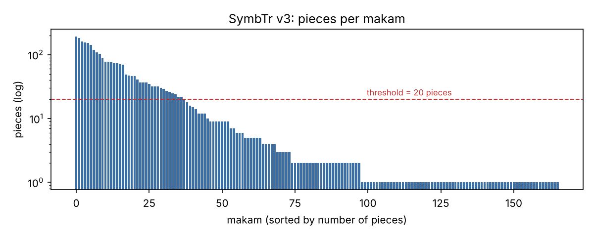
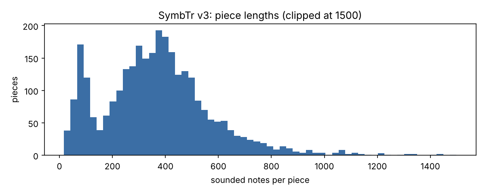

# SymbTr v3 data report

Generated by `scripts/01_data_report.py`. Numbers are computed from the files in `symbtr_v3/txt_v3`; makam/form/usul labels are taken from the file names.

## Overview

| Measure | Value |
|---|---|
| Pieces (files) | 3000 |
| Makam labels | 166 |
| Usul labels | 111 |
| Form labels | 62 |
| Sounded notes | 1,144,685 |
| Total rows (all Kod values) | 1,211,922 |
| Sounded notes per piece (median / mean) | 370 / 382 |
| Shortest / longest piece | 0 / 6035 |
| Distinct pitches (Koma53) | 119 |
| Distinct durations (Pay/Payda) | 68 |

## Makam distribution (long tail)

| Threshold | Makams below threshold |
|---|---|
| < 2 pieces | 68 |
| < 5 pieces | 102 |
| < 10 pieces | 120 |
| < 20 pieces | 128 |
| < 50 pieces | 149 |

| Threshold | Makams | Pieces | Share of pieces |
|---|---|---|---|
| ≥ 10 pieces | 46 | 2724 | 91% |
| ≥ 20 pieces | 38 | 2615 | 87% |
| ≥ 50 pieces | 17 | 1919 | 64% |
| ≥ 100 pieces | 9 | 1311 | 44% |

**Makams with at least 20 pieces:**

| Makam | Pieces | Notes | Most frequent final pitch (Koma53) | Share of pieces ending on it |
|---|---|---|---|---|
| nihavent | 192 | 77,774 | 296 | 90% |
| hicaz | 182 | 64,267 | 305 | 99% |
| ussak | 160 | 57,198 | 305 | 99% |
| rast | 154 | 58,684 | 296 | 97% |
| huzzam | 152 | 63,356 | 313 | 97% |
| kurdilihicazkar | 141 | 58,459 | 296 | 97% |
| huseyni | 118 | 44,048 | 305 | 96% |
| segah | 109 | 46,490 | 313 | 97% |
| mahur | 103 | 45,518 | 296 | 95% |
| hicazkar | 88 | 37,425 | 296 | 86% |
| beyati | 78 | 35,003 | 305 | 100% |
| muhayyer | 78 | 32,633 | 305 | 97% |
| hicaz_uzzal | 76 | 28,340 | 305 | 99% |
| saba | 74 | 27,640 | 305 | 99% |
| buselik | 73 | 26,271 | 305 | 97% |
| karcigar | 71 | 27,193 | 305 | 94% |
| acemasiran | 70 | 26,229 | 287 | 91% |
| muhayyerkurdi | 49 | 18,385 | 305 | 100% |
| hicaz_humayun | 47 | 18,879 | 305 | 100% |
| acemkurdi | 46 | 15,555 | 305 | 100% |
| suzinak | 46 | 15,906 | 296 | 100% |
| neveser | 41 | 22,763 | 296 | 90% |
| evic | 37 | 15,785 | 291 | 100% |
| nikriz | 37 | 16,133 | 296 | 97% |
| suzidil | 37 | 16,953 | 283 | 95% |
| tahir | 35 | 13,200 | 305 | 100% |
| gerdaniye | 32 | 11,250 | 305 | 100% |
| nisaburek | 32 | 12,046 | 305 | 100% |
| sehnaz | 32 | 13,454 | 305 | 88% |
| yegah | 30 | 10,091 | 274 | 100% |
| sultaniyegah | 29 | 10,497 | 274 | 97% |
| hicaz_zirgule | 27 | 7,352 | 305 | 100% |
| isfahan | 26 | 10,145 | 305 | 96% |
| hisarbuselik | 25 | 9,692 | 305 | 100% |
| neva | 24 | 11,884 | 305 | 92% |
| ruhnevaz | 22 | 10,968 | 283 | 91% |
| suzinak_zirgule | 22 | 10,280 | 296 | 100% |
| kurdi | 20 | 5,359 | 305 | 95% |

## Usul and form

- Usuls with fewer than 5 pieces: 70 of 111; usuls with at least 20 pieces: 20 (89% of pieces).
- Most frequent usuls: duyek (439), aksak (439), sofyan (365), curcuna (187), aksaksemai (175), agiraksak (139), semai (138), nimsofyan (133), yuruksemai (92), senginsemai (89).
- Most frequent forms: sarki (1520), turku (353), seyir (173), sazsemaisi (122), kupe (120), pesrev (118), aranagme (76), ilahi (61), beste (61), agirsemai (47).

## Piece lengths

## Vocabulary

- The 20 most frequent duration values cover 99.9% of all notes/rests (out of 68 distinct values).
- Pitch range (Koma53): 243–424; the 60 most frequent pitches cover 99.8% of sounded notes.
- Row types (Kod): 9: 1,164,783, 8: 15,984, 10: 6,793, 1: 6,009, 11: 5,533, 7: 3,807, 12: 3,443, 52: 2,575.

## Piece-level stratified split

`data/splits.csv` (seed 13). Rule: 80/10/10 within each makam that has at least 20 pieces; all other makams go to the `few_shot` pool (for few-shot generalisation experiments). Files sharing the same title and composer (28 groups) are kept in the same set.

| Set | Pieces | Sounded notes |
|---|---|---|
| train | 2070 | 815,744 |
| val | 320 | 114,860 |
| test | 241 | 104,852 |
| few_shot | 369 | 109,229 |

## Notes

- Files use mixed encodings (UTF-8 and Windows-1254); the parser tries both.
- Label counts from file names do not match the Zenodo record exactly (164 makams, 135 usuls, 61 forms). The difference may come from label variants (e.g. `hicaz_uzzal`, `yuruksemai_4`) and pieces with usul changes; this needs a separate check.
- The txt files hold the performance order with repeats expanded; note-level alignment with the printed score needs the mu2/MusicXML versions.
- **Known issue of the split.** Grouping by title and composer treats generically titled files as one composition: 72 `aranagme` files titled "1" with no composer all went to validation (many are excerpts of songs in training), and blocks of `seyir` examples by one author were assigned to a single set regardless of makam. The test set is not affected (see `preliminary_results.md`, Audit). `data/splits.csv` is kept unchanged because all reported runs use it; a corrected split should replace it before the experiments for publication.
