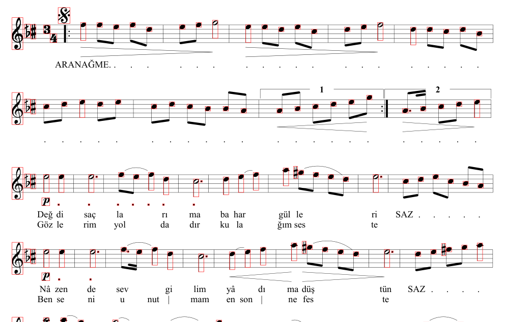
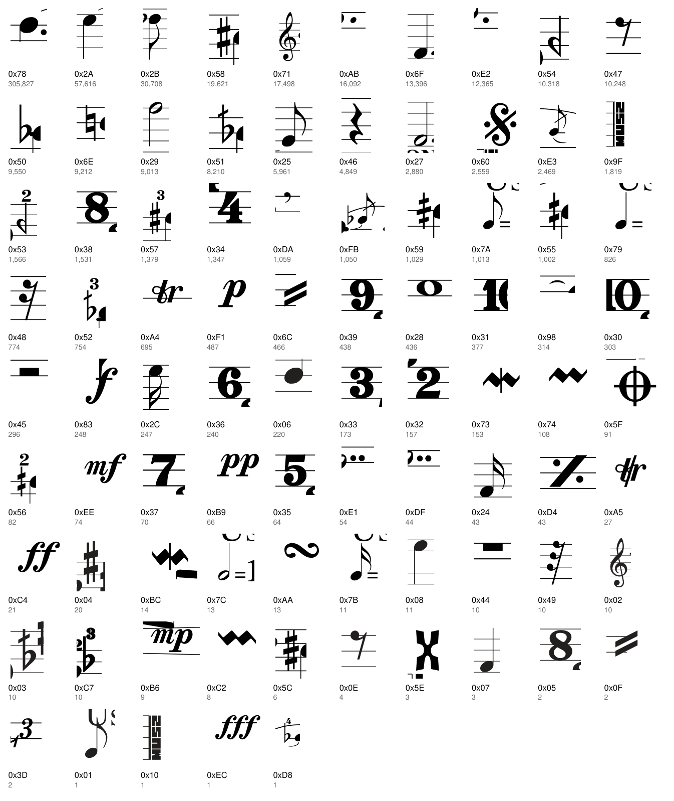

# SymbTr PDF'lerinden otomatik sembol etiketi: fizibilite raporu

`scripts/02_pdf_sembol_envanteri.py` ve `src/pdf_semboller.py` ile üretilmiştir. Ayrıntılı sayılar `pdf_sembol_ozeti.json` ve `pdf_sembol_envanteri.csv` dosyalarındadır.

## Yöntem

SymbTr v3 PDF'leri taranmış görüntü değil vektör dosyalardır. Müzik sembolleri gömülü **Mus2** fontunun karakterleridir. Her karakterin sayfadaki konumu PDF'ten, sıkı sınır kutusu gömülü fontun glif sınırlarından hesaplanır; sınıf etiketi karakterin font içindeki kodudur. Elle etiketleme yapılmaz.

## Sonuç

| Grup | Dosya | Sayfa | Durum |
|---|---|---|---|
| Mus2 TrueType gömülü, tüm semboller çıkarıldı | 1.656 | 2.260 | Kullanıma hazır: ~500 bin sembol kutusu |
| Mus2 TrueType + ikinci alt küme (kısmi) | 218 | 315 | İkinci alt küme için glif indeksiyle çıkarım gerekli |
| Mus2 CFF/Type0 gömülü | 593 | 809 | Aynı yöntem, glif indeksi üzerinden; sınıf eşlemesi ayrıca yapılmalı |
| Mus2 fontu görünmüyor (yol/raster/adsız font) | 532 | 1.082 | Otomatik çıkarım yok; model destekli etiketleme veya alan dışı test kümesi adayı |
| **Toplam** | 2.999 | 4.466 | |

- 85 farklı sembol kodu bulundu (aşağıdaki atlas). Koma temelli arızalar, nota başları, bayraklı notalar, suslar, anahtar, ölçü sayıları, nüans ve süsleme işaretleri ayrı kodlardır.
- En sık sembol dolu nota başıdır (0x78); dağılım uzun kuyrukludur, bazı arıza kodları birkaç bin örnekle sınırlıdır.

## Sınırlar ve yapılacaklar

1. **Vektör çizimler:** Dizek ve ölçü çizgileri, kirişli notaların sapları, kirişler, bağlar ve volta köşeli parantezleri font karakteri değil çizimdir. Konumları PDF'ten alınabiliyor (`page_drawings`), ancak sınıflandırılmaları kural gerektiriyor; henüz doğrulanmadı.
2. **Sınıf adları:** 85 kodun müzikal adlarla (örn. koma bemolü, bakiye diyezi) eşlenmesi atlas üzerinden elle yapılmalı ve danışmanla doğrulanmalı.
3. **Dizgi stili tek:** Tüm sayfalar Mus2 çıktısı. Tarama bozulması yok; bas-tara alt kümesi ve dördüncü gruptaki 532 dosya stil/alan çeşitliliği için kullanılabilir.
4. **Nota düzeyinde doğru yanıt:** txt dosyaları tekrarları açılmış icra sırasını içerir; basılı sayfayla birebir hizalama için mu2/MusicXML sürümleri depoya eklenmeli.
5. Depoda `pdf_v3` klasöründe 2.999 PDF ve bir adet `.csv` dosyası var; bir eserin PDF'i eksik görünüyor.
