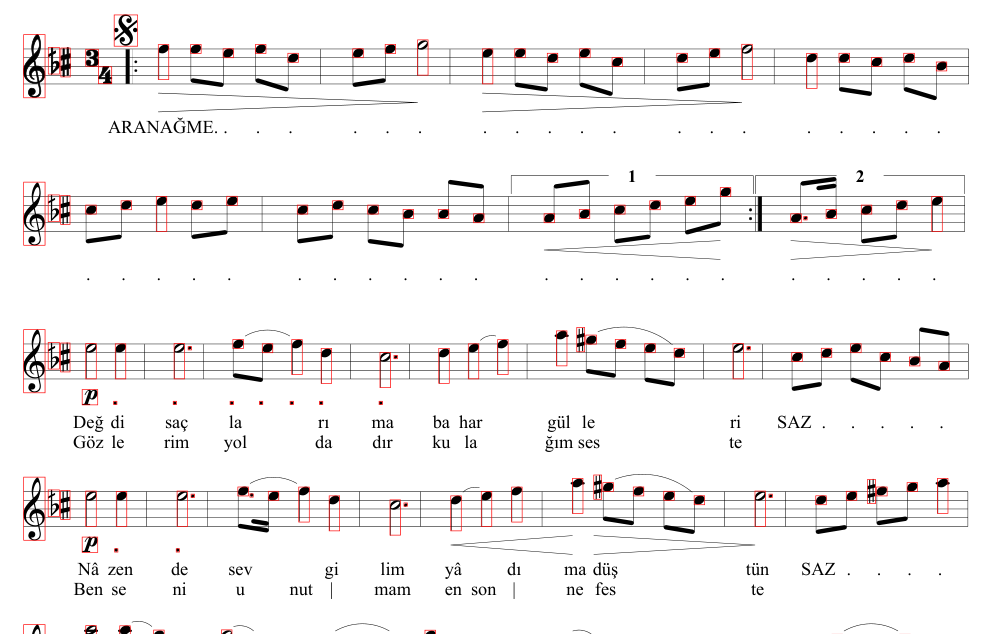
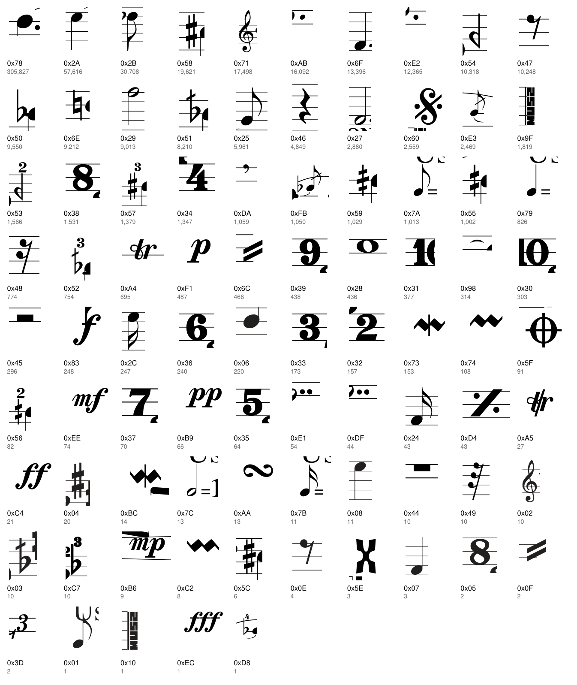

# Automatic symbol labels from SymbTr PDFs: feasibility report

Generated with `scripts/02_pdf_symbol_inventory.py` and `src/pdf_symbols.py`. Detailed numbers are in `pdf_symbol_summary.json` and `pdf_symbol_inventory.csv`; per-file results are in `data/pdf_page_counts.csv`.

## Method

The SymbTr v3 PDFs are vector files, not scans. Music symbols are characters of the embedded **Mus2** font. The position of each character on the page is read from the PDF, the tight bounding box is computed from the glyph bounds of the embedded font, and the class label is the character's code in the font. No manual annotation is involved.

## Result

| Group | Files | Pages | Status |
|---|---|---|---|
| Mus2 embedded as TrueType, all symbols extracted | 1,656 | 2,260 | Ready to use: about 500k symbol boxes |
| Mus2 TrueType plus a second subset (partial) | 218 | 315 | Second subset needs extraction by glyph index |
| Mus2 embedded as CFF/Type0 | 593 | 809 | Same method via glyph index; class mapping still to be built |
| No Mus2 font visible (paths, raster or unnamed font) | 532 | 1,082 | No automatic extraction; candidate for model-assisted labelling or an out-of-domain test set |
| **Total** | 2,999 | 4,466 | |

- 85 distinct symbol codes were found (atlas below). Comma-based accidentals, noteheads, flagged notes, rests, clef, time-signature digits, dynamics and ornament signs are separate codes.
- The most frequent symbol is the filled notehead (0x78). The distribution is long-tailed; some accidental codes have only a few thousand instances.
- Box correctness was checked visually on sample pages only; there is no quantitative validation yet.

## Limitations and next steps

1. **Vector drawings:** staff lines, barlines, stems of beamed notes, beams, slurs and volta brackets are drawings, not font characters. Their positions are available (`page_drawings`), but assigning classes needs rules that are not written or validated yet.
2. **Class names:** the 85 codes must be mapped to musical names (e.g. koma flat, bakiye sharp) by hand from the atlas and confirmed with the project advisor.
3. **Single engraving style:** all pages are Mus2 output with no scanning degradation. A print-and-scan subset and the 532 files of the fourth group can provide style/domain variety.
4. **Note-level ground truth:** the txt files hold the performance order with repeats expanded (in the example piece: 187 notes in txt, 136 noteheads in the PDF). Alignment with the printed page should use the mu2/MusicXML versions.
5. `pdf_v3` holds 2,999 PDFs; the PDF of `ussak--yuruksemai--yuruksemai_4--kah_ki--kara_ismail_aga` is missing.
