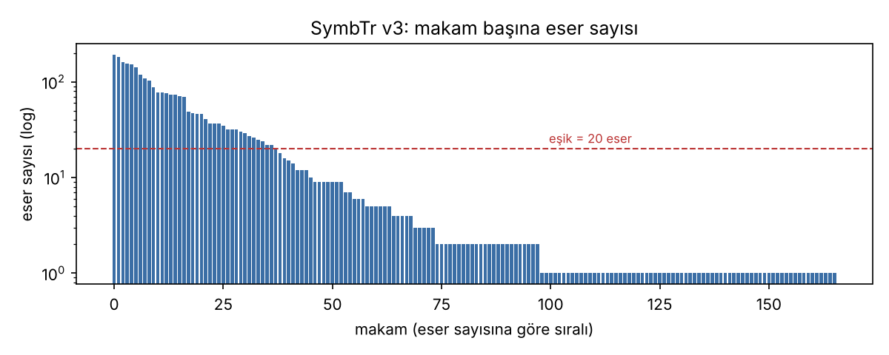
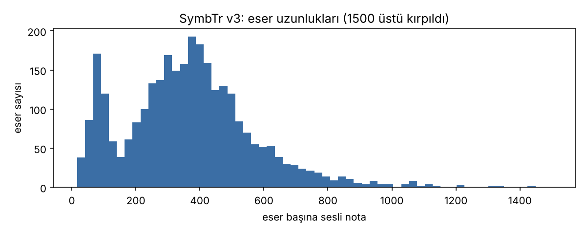

# SymbTr v3 veri raporu

`scripts/01_veri_raporu.py` tarafından üretilmiştir. Sayılar `symbtr_v3/txt_v3` içindeki dosyalardan hesaplanır; makam/form/usûl etiketleri dosya adından alınır.

## Genel

| Ölçü | Değer |
|---|---|
| Eser (dosya) | 3000 |
| Makam etiketi | 166 |
| Usûl etiketi | 111 |
| Form etiketi | 62 |
| Sesli nota | 1,119,282 |
| Toplam satır (tüm Kod değerleri) | 1,211,922 |
| Eser başına sesli nota (ortanca / ortalama) | 362 / 373 |
| En kısa / en uzun eser | 17 / 5595 |
| Farklı perde (Koma53) | 119 |
| Farklı süre (Pay/Payda) | 67 |

## Makam dağılımı (uzun kuyruk)

| Eşik | Eşiğin altındaki makam sayısı |
|---|---|
| < 2 eser | 68 |
| < 5 eser | 102 |
| < 10 eser | 120 |
| < 20 eser | 128 |
| < 50 eser | 149 |

| Eşik | Makam | Eser | Eser payı |
|---|---|---|---|
| ≥ 10 eser | 46 | 2724 | %91 |
| ≥ 20 eser | 38 | 2615 | %87 |
| ≥ 50 eser | 17 | 1919 | %64 |
| ≥ 100 eser | 9 | 1311 | %44 |

**En az 20 eseri olan makamlar** (eser / sesli nota):

| Makam | Eser | Nota | En sık bitiş perdesi (Koma53) | Bu perdede biten eser payı |
|---|---|---|---|---|
| nihavent | 192 | 76,750 | 296 | %90 |
| hicaz | 182 | 63,198 | 305 | %99 |
| ussak | 160 | 56,795 | 305 | %99 |
| rast | 154 | 58,647 | 296 | %97 |
| huzzam | 152 | 62,325 | 313 | %97 |
| kurdilihicazkar | 141 | 57,220 | 296 | %97 |
| huseyni | 118 | 43,392 | 305 | %96 |
| segah | 109 | 44,455 | 313 | %97 |
| mahur | 103 | 44,459 | 296 | %95 |
| hicazkar | 88 | 37,205 | 296 | %86 |
| beyati | 78 | 34,214 | 305 | %100 |
| muhayyer | 78 | 31,268 | 305 | %97 |
| hicaz_uzzal | 76 | 28,124 | 305 | %99 |
| saba | 74 | 28,539 | 305 | %97 |
| buselik | 73 | 25,322 | 305 | %97 |
| karcigar | 71 | 26,806 | 305 | %94 |
| acemasiran | 70 | 25,779 | 287 | %91 |
| muhayyerkurdi | 49 | 17,851 | 305 | %100 |
| hicaz_humayun | 47 | 18,343 | 305 | %100 |
| acemkurdi | 46 | 15,416 | 305 | %100 |
| suzinak | 46 | 15,610 | 296 | %100 |
| neveser | 41 | 22,758 | 296 | %90 |
| evic | 37 | 14,441 | 291 | %100 |
| nikriz | 37 | 15,385 | 296 | %97 |
| suzidil | 37 | 15,055 | 283 | %95 |
| tahir | 35 | 12,302 | 305 | %100 |
| gerdaniye | 32 | 10,745 | 305 | %100 |
| nisaburek | 32 | 11,795 | 305 | %100 |
| sehnaz | 32 | 12,035 | 305 | %88 |
| yegah | 30 | 9,725 | 274 | %100 |
| sultaniyegah | 29 | 10,376 | 274 | %97 |
| hicaz_zirgule | 27 | 7,311 | 305 | %100 |
| isfahan | 26 | 9,674 | 305 | %96 |
| hisarbuselik | 25 | 8,622 | 305 | %100 |
| neva | 24 | 11,618 | 305 | %92 |
| ruhnevaz | 22 | 10,968 | 283 | %91 |
| suzinak_zirgule | 22 | 9,013 | 296 | %100 |
| kurdi | 20 | 5,279 | 305 | %95 |

## Usûl ve form

- 5'ten az eseri olan usûl: 70 / 111; en az 20 eseri olan usûl: 20 (eserlerin %89'i).
- En sık usûller: duyek (439), aksak (439), sofyan (365), curcuna (187), aksaksemai (175), agiraksak (139), semai (138), nimsofyan (133), yuruksemai (92), senginsemai (89).
- En sık formlar: sarki (1520), turku (353), seyir (173), sazsemaisi (122), kupe (120), pesrev (118), aranagme (76), ilahi (61), beste (61), agirsemai (47).

## Eser uzunlukları

## Sözlük

- En sık 20 süre değeri tüm nota/susların %99.9'ini kapsıyor (67 farklı değerden).
- Perde aralığı (Koma53): 243–424; en sık 60 perde sesli notaların %99.9'ini kapsıyor.
- Satır türleri (Kod): 9: 1,164,783, 8: 15,984, 10: 6,793, 1: 6,009, 11: 5,533, 7: 3,807, 12: 3,443, 52: 2,575.

## Eser bazlı katmanlı bölme

`data/bolmeler.csv` (tohum 13). Kural: en az 20 eserli makamlarda makam içinde 80/10/10; diğer makamlar `az_ornekli` havuzunda (az örnekli genelleme deneyleri için). Aynı eser adı ve besteciye sahip dosyalar (28 grup) aynı kümede tutulur.

| Küme | Eser | Sesli nota |
|---|---|---|
| egitim | 2070 | 796,787 |
| dogrulama | 320 | 111,458 |
| test | 241 | 102,896 |
| az_ornekli | 369 | 108,141 |

## Notlar

- Dosyalar karışık kodlamalı (UTF-8 ve Windows-1254); ayrıştırıcı ikisini de dener.
- Dosya adındaki etiketler Zenodo kaydında bildirilen sayılarla (164 makam, 135 usûl, 61 form) birebir örtüşmüyor; fark etiket varyantlarından (örn. `hicaz_uzzal`, `yuruksemai_4`) ve usûl değişimli eserlerden kaynaklanıyor olabilir, ayrıca incelenmeli.
- txt dosyaları tekrarları açılmış icra sırasını içerir; basılı notadaki tekrar işaretleriyle birebir hizalama için mu2/MusicXML sürümleri gerekir.
